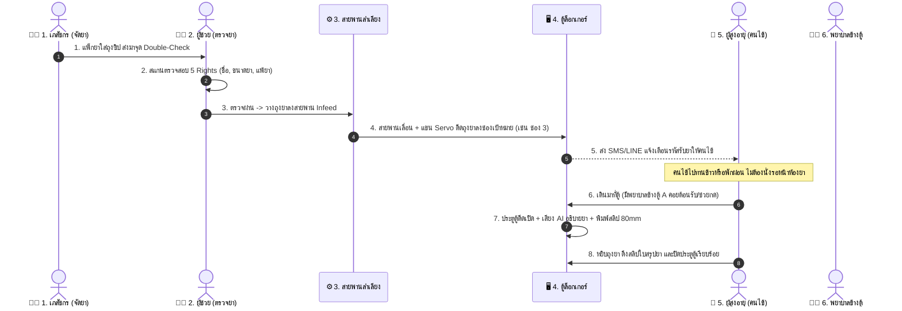

# 📖 เล่มคู่มือโครงการ & บทนำเสนอพิชชิ่งระดับมืออาชีพ
# SMART PHARMACY LOCKER
### ระบบตู้ล็อกเกอร์รับยาอัตโนมัติพร้อมสายพานลำเลียงอัจฉริยะ และผู้ช่วยอธิบายยาสำหรับผู้สูงอายุ
*(Automated Infeed Sorting Locker & Elderly-Centric Medication Assistant)*

---

## 📑 สารบัญ (Table of Contents)
1. **บทสรุปผู้บริหาร & Elevator Pitch (Executive Summary)**
2. **ที่มา ปัญหา และความจำเป็นเร่งด่วน (The Pain Points & Opportunity)**
3. **แนวคิดและนวัตกรรม 4 มิติ (The 4-Pillar Innovation)**
4. **สถาปัตยกรรมระบบ & แผนผังการทำงาน (System Architecture & Workflow)**
5. **พิมพ์เขียวต้นแบบจำลอง (Hardware Mock-up & Mechatronics Blueprint)**
6. **โครงสร้างซอฟต์แวร์ & ฟังก์ชันเด่น (Software Features & Implementation)**
7. **บทสคริปต์นำเสนอพิชชิ่งทีละสไลด์ 5–7 นาที (Slide-by-Slide Pitching Script)**
8. **กลยุทธ์การสาธิตหน้างาน (Live Demonstration Flow)**
9. **การวิเคราะห์ความคุ้มค่า & ผลกระทบทางสังคม (Impact & Feasibility)**
10. **คลังคำถาม-คำตอบปราบเซียนจากคณะกรรมการ (Jury Q&A Defense)**

---

## 1. บทสรุปผู้บริหาร & Elevator Pitch (Executive Summary)

### 🎯 คำขวัญโครงการ (Tagline)
> **"ลดเวลารอคอย ปลอดภัยด้วย Double-Check อุ่นใจด้วยพยาบาลดูแล และเข้าใจผู้สูงอายุอย่างแท้จริง"**

### ⏱️ Elevator Pitch (บทสรุป 60 วินาที สำหรับเปิดหัวการนำเสนอ)
> *"ทุกวันนี้ ผู้ป่วยนอกในโรงพยาบาลรัฐกว่า 60% เป็นผู้สูงอายุที่ต้องนั่งรอรับยาหน้าห้องยานานถึง 2-3 ชั่วโมง จนอ่อนล้า และเมื่อถึงคิว เภสัชกรก็มีเวลาอธิบายวิธีทานยาเพียงไม่กี่สิบวินาที ทำให้คนแก่จำวิธีใช้ยาไม่ได้ กลับไปทานยาผิดจนเกิดอันตราย*
> 
> *วันนี้เราขอเสนอ **Smart Pharmacy Locker** ระบบรับยาอัตโนมัติที่คิดค้นขึ้นเพื่อแก้ปัญหานี้อย่างครบวงจร: หลังจากเภสัชกรจัดยา มีสถานี **Double-Check** ตรวจสอบ 5 Rights แล้ววางลง **สายพานลำเลียงอัตโนมัติ** คัดแยกยาเข้าตู้ล็อกเกอร์เอง คนไข้ไม่ต้องนั่งเฝ้าหน้าห้องยา เมื่อมาถึงตู้ จะมี **พยาบาลสแตนด์บายคอยช่วยเหลือ** หน้าจอแสดงตัวหนังสือยักษ์ **มีเสียง AI ภาษาไทยพูดช้าชัดเจน** และพิมพ์ใบสรุปยากระดาษความร้อน 80mm ให้กลับบ้าน ทั้งปลอดภัย สะดวก และเปี่ยมด้วยความอบอุ่นครับ"*

---

## 2. ที่มา ปัญหา และความจำเป็นเร่งด่วน (The Pain Points)

จากการสำรวจกระบวนการจ่ายยาผู้ป่วยนอก (OPD Pharmacy) ในโรงพยาบาลศูนย์และโรงพยาบาลทั่วไป พบปัญหาคอขวด 3 ประการหลัก:

```
[ คนไข้แออัด ] ---------> [ เภสัชกรภาระงานล้น ] ---------> [ คนแก่ลืมวิธีกินยา ]
รอคิวรับยา 2-3 ชม.        มีเวลาอธิบายยา < 45 วิ/คน       อ่านฉลากซองยาไม่ออก
เสี่ยงติดเชื้อใน รพ.       เสี่ยงจ่ายยาผิด (Human Error)     กินยาผิดโรค/เข้า รพ. ซ้ำ
```

### 1. ปัญหาฝั่งผู้ป่วยและญาติ (Patient & Family Pain Points)
* **เวลารอคอยมหาศาล (2–3 ชั่วโมง):** ตรวจเสร็จตั้งแต่ 10 โมงเช้า แต่ต้องนั่งรอรับยาจนถึงบ่าย ทำให้ผู้สูงอายุเหนื่อยล้า และเพิ่มความเสี่ยงติดเชื้อในโรงพยาบาล
* **ข้อจำกัดทางสรีรวิทยาของผู้สูงอายุ:** สายตาฝ้าฟาง อ่านตัวหนังสือจิ๋วบนซองยาไม่ออก หูตึงฟังคำแนะนำไม่ทัน และลูกหลานที่ไม่ได้มาโรงพยาบาลด้วยก็ไม่รู้ว่าต้องดูแลการกินยาอย่างไร

### 2. ปัญหาฝั่งเภสัชกรและบุคลากรทางการแพทย์ (Staff Burnout)
* **ความเร่งรีบแข่งกับเวลา:** ห้องยาต้องจ่ายยาวันละ 800–1,500 ใบสั่งยา เภสัชกรต้องก้มหน้าก้มตาจัดยาและเร่งพูดอธิบาย ทำให้เกิดภาวะหมดไฟ (Burnout)
* **ความเสี่ยงในการจัดส่งยาเข้าตู้:** หากใช้ตู้ล็อกเกอร์แบบเดิม เจ้าหน้าที่ต้องเดินถือถุงยาไปไขกุญแจยัดทีละช่อง เสียเวลาและอาจใส่ผิดช่องได้

### 3. ปัญหาของเทคโนโลยีอัตโนมัติทั่วไปในท้องตลาด (Market Gap)
* **เครื่องจ่ายยาอัตโนมัติของต่างประเทศ (เช่น Swisslog / BD Rowa):** ราคาแพงหลัก 15–30 ล้านบาท โรงพยาบาลทั่วไปเข้าไม่ถึง
* **ตู้รับพัสดุทั่วไป (Smart Locker ทั่วไป):** ออกแบบมาสำหรับคนรุ่นใหม่ (ใช้แอป/สแกนไวๆ) ไม่รองรับผู้สูงอายุ ไม่มีเสียงบรรยายภาษาไทย และไม่มีมาตรการความปลอดภัยทางการแพทย์

---

## 3. แนวคิดและนวัตกรรม 4 มิติ (The 4-Pillar Innovation)

โปรเจกต์นี้ไม่ได้มองแค่เรื่อง "ตู้เหล็กใส่ของ" แต่มองเป็น **กระบวนการบริการสุขภาพแบบไร้รอยต่อ (Seamless Healthcare Service Design)** ประกอบด้วย 4 มิติ:

```
                  ┌─────────────────────────────────────────┐
                  │      SMART PHARMACY LOCKER SYSTEM       │
                  └────────────────────┬────────────────────┘
                                       │
     ┌──────────────────┬──────────────┴─────┬──────────────────┐
     ▼                  ▼                    ▼                  ▼
[ 1. Double-Check ]  [ 2. Auto Conveyor ]  [ 3. Nurse Standby ] [ 4. Elderly Kiosk ]
 ตรวจ 5 Rights ปลอดภัย สายพานปัดยาเข้าช่อง    มีผู้ช่วยดูแลข้างตู้  เสียง AI + สลิป 80mm
```

1. **Safety First: สถานี Double-Check 5 Rights**
   * เภสัชกรจัดยาเสร็จ มีผู้ช่วย/พยาบาลตรวจซ้ำ (ถูกคน, ถูกยา, ถูกขนาด, ถูกเวลา, ประวัติแพ้ยา) ป้องกัน Human Error 100% ตามมาตรฐาน JCI
2. **Mechatronics Automation: ระบบสายพาน Infeed และคัดแยกอัตโนมัติ**
   * ไม่ต้องให้คนเดินไปยัดยาเข้าช่อง เพียงแค่วางบนสายพาน แขนกล Servo Flipper จะปัดถุงยาตกเข้าช่องเป้าหมายเองอย่างแม่นยำ
3. **Human-in-the-Loop: พยาบาล/เจ้าหน้าที่สแตนด์บายข้างตู้ (Concierge Model)**
   * ผสานเทคโนโลยีเข้ากับความอบอุ่น มีปุ่มเรียกพยาบาล และมีโหมด Staff Override ช่วยเหลือคนแก่ที่ลืมรหัสหรือสายตาพร่ามัว
4. **Elderly-Centric Kiosk: หน้าจอที่เป็นมิตรกับคนแก่ที่สุด**
   * เสียงสังเคราะห์ภาษาไทยพูดช้าชัดเจน (Rate 0.88x)
   * ตัวหนังสือยักษ์ คอนทราสต์สีชัดเจน มองเห็นง่าย
   * เครื่องพิมพ์ Thermal 80mm พิมพ์สลิปใบสรุปยากลับบ้านทันที
   * ส่งข้อมูลการกินยาเข้า LINE ของลูกหลานอัตโนมัติ

---

## 4. สถาปัตยกรรมระบบ & แผนผังการทำงาน (System Architecture & Workflow)



---

## 5. พิมพ์เขียวต้นแบบจำลอง (Hardware Mock-up & Blueprint)

สำหรับการส่งงาน/ประกวด/ทำ Demo ใช้อุปกรณ์ราคาประหยัดที่หาซื้อง่าย แต่ทำงานได้จริงแบบ Real-time:

### 📦 รายการวัสดุอุปกรณ์และงบประมาณต้นแบบ (Bill of Materials)

| รายการ | รายละเอียดสเปก | หน้าที่ในระบบ | งบประมาณ (โดยประมาณ) |
| :--- | :--- | :--- | :---: |
| **1. โครงตู้ล็อกเกอร์** | ฟิวเจอร์บอร์ด/โฟมบอร์ด/อะคริลิกใส (30×20×40 ซม.) | แบ่งเป็น 4 ช่อง (2×2) ทำประตูบานพับ | 150 – 250 บาท |
| **2. จอหน้าตู้ (Front Screen)** | Tablet หรือโทรศัพท์มือถือเครื่องเก่า | หน้าจอรับยาสำหรับคนแก่ (เปิด `?view=front`) | 0 บาท (ใช้ของเดิม) |
| **3. จอหลังตู้ (Rear Screen)** | โน้ตบุ๊ก หรือจอคอมพิวเตอร์/Tablet | หน้าจอผู้ช่วยตรวจ 5 Rights & สั่งสายพาน (`?view=back`) | 0 บาท (ใช้คอมที่มี) |
| **4. เครื่องพิมพ์ใบยา** | Mini Thermal Printer 58mm หรือ 80mm USB/Bluetooth | พิมพ์สลิปตารางสรุปการทานยาตัวโตๆ | 450 – 850 บาท |
| **5. บอร์ดควบคุม** | ESP32 Wi-Fi Microcontroller | รับคำสั่งจากหน้าเว็บเพื่อสั่งเปิดปิดมอเตอร์ | 120 – 150 บาท |
| **6. กลไกเปิดประตู & คัดแยก** | Servo Motor SG90 (3–4 ตัว) | ปลดสลักประตูตู้ และทำแขนปัดบนสายพาน | 120 – 160 บาท |
| **7. สายพานลำเลียงจำลอง** | ชุดคิท DIY Mini Conveyor (หรือทำเองด้วยมอเตอร์ DC 5V) | เลื่อนถุงยาจากจุดตรวจเข้าตู้ | 300 – 500 บาท |
| **8. ไฟสถานะ LED** | หลอด LED สีเขียว/แดง + ตัวต้านทาน | แสดงไฟกระพริบช่องที่เปิดออก | 30 บาท |
| **รวมงบประมาณทั้งสิ้น** | | | **~1,200 – 1,900 บาท** |

---

### 🔌 แผนผังการต่อสายฮาร์ดแวร์ (ESP32 Wiring)

```
       ┌──────────────────────────────┐
       │         ESP32 Board          │
       │                              │
       │  GPIO 18 ──────> Servo 1 (แขนปัดสายพาน / สลักตู้ 1)
       │  GPIO 19 ──────> Servo 2 (สลักตู้ 2)
       │  GPIO 21 ──────> LED สีเขียว (ไฟตู้ 1)
       │  GPIO 22 ──────> LED สีเขียว (ไฟตู้ 2)
       │  GPIO 23 ──────> Relay / มอเตอร์สายพาน DC
       │  5V / VIN ────> แหล่งจ่ายไฟภายนอก 5V (Adapter/Powerbank)
       │  GND ─────────> กราวด์ร่วม (Common GND)
       └──────────────────────────────┘
```

---

## 6. โครงสร้างซอฟต์แวร์ & ฟังก์ชันเด่น (Software Features)

ระบบซอฟต์แวร์ถูกสร้างด้วยสถาปัตยกรรมโมเดิร์นเว็บ (Vite + React 19 + Tailwind CSS) รองรับการเชื่อมต่อข้ามอุปกรณ์อย่างไร้รอยต่อ:

### 1. สถานี Double-Check & สายพาน (`DoubleCheckConveyorView.jsx`)
* **5 Rights Safety Checklist:** ตรวจสอบความถูกต้องของคนไข้, ตัวยา, ขนาด, เวลา และประวัติการแพ้ยา
* **Interactive 2D Conveyor Simulation:** กราฟิกจำลองสายพานหมุน ถุงยาวิ่ง และแขนกล Servo ปัดถุงยาตกเข้าช่องตู้แบบเรียลไทม์ พร้อมไฟ LED และเสียงสังเคราะห์
* **Hardware Webhook API:** ส่งสัญญาณ `GET http://[ESP32-IP]/conveyor?box=X` ขับเคลื่อนมอเตอร์จริง

### 2. ตู้รับยาสำหรับผู้สูงอายุ (`KioskView.jsx`)
* **Elderly Accessibility UI:** สีสันคอนทราสต์ชัดเจน ตัวหนังสือขนาดใหญ่ แตะใช้งานง่าย
* **Thai Speech Synthesis Engine (`voiceService.js`):** ปรับความเร็ว 0.88x น้ำเสียงอบอุ่นเพื่อคนสูงวัย
* **Emergency Nurse Call Modal:** ปุ่มสีแดงใหญ่ "🆘 แตะเรียกพยาบาล" ส่งสัญญาณและมีเสียงปลอบโยน
* **Station Staff Override:** โหมดพิเศษสำหรับพยาบาลค้นหาชื่อคนไข้และกดปุ่มเดียวเปิดตู้ได้ทันที

### 3. ระบบใบสรุปยาความร้อน 80mm (`PrintSlipModal.jsx`)
* ออกแบบ CSS สำหรับเครื่องพิมพ์ใบเสร็จความร้อน 80mm โดยเฉพาะ มีไอคอนมื้อยา 🌅 ☀️ ☕ 🌙 และข้อความเน้นย้ำความปลอดภัย

---

## 7. สคริปต์นำเสนอพิชชิ่งทีละสไลด์ 5–7 นาที (Slide-by-Slide Pitch Script)

นำสคริปต์นี้ไปซ้อมพูดคู่กับสไลด์ได้ทันที:

### สไลด์ที่ 1: ปกและเปิดประเด็น (0:00 - 0:45 นาที)
* **เนื้อหาบนสไลด์:** ชื่อโปรเจกต์ "Smart Pharmacy Locker", รูปผู้สูงอายุนั่งรอคิวห้องยา, สถิติ "เวลารอคอยยาเฉลี่ย 2.5 ชม."
* **บทพูด:**
  > *"สวัสดีคณะกรรมการทุกท่านครับ ทุกท่านเคยพาคุณพ่อ คุณแม่ หรือคุณตาคุณยายไปหาหมอที่โรงพยาบาลไหมครับ? สิ่งที่เหนื่อยที่สุดไม่ใช่ตอนตรวจกับคุณหมอครับ แต่คือการมานั่งรอคิวรับยาหน้าห้องยาที่กินเวลานานถึง 2-3 ชั่วโมง คนแก่หลายคนนั่งจนปวดหลัง อ่อนเพลีย และที่แย่กว่านั้นคือ เมื่อถึงคิวรับยา เภสัชกรมีเวลาอธิบายวิธีทานยาเพียงแค่ไม่กี่สิบวินาที กลับบ้านไปคนแก่จำไม่ได้ อ่านฉลากไม่ออก จนกินยาผิดเข้าโรงพยาบาลซ้ำ*
  > 
  > *วันนี้ กลุ่มของพวกเราขอเสนอนวัตกรรม **Smart Pharmacy Locker** ตู้รับยาอัจฉริยะที่ออกแบบมาเพื่อคืนเวลา คืนความปลอดภัย และเข้าใจผู้สูงอายุไทยอย่างแท้จริงครับ"*

---

### สไลด์ที่ 2: เจาะลึกปัญหา & ทำไมตู้ทั่วไปถึงตอบโจทย์ไม่ได้ (0:45 - 1:30 นาที)
* **เนื้อหาบนสไลด์:** กราฟิกเปรียบเทียบ: ตู้พัสดุทั่วไป (ไม่ปลอดภัย ไม่มีคนช่วย) vs ตู้ยานำเข้า (แพง 20 ล้าน)
* **บทพูด:**
  > *"หลายคนอาจถามว่า 'แล้วทำไมไม่เอาตู้ฝากพัสดุทั่วไปมาใส่ยา?' คำตอบคือ **เรื่องยาเป็นเรื่องของชีวิตครับ** จะเอาตู้พัสดุมาใส่ยาไม่ได้ เพราะขาดมาตรฐานความปลอดภัยทางการแพทย์ และถ้าไม่มีเจ้าหน้าที่คอยช่วยเหลือ คนแก่ก็กดไม่เป็นอยู่ดี*
  > 
  > *ส่วนเครื่องจ่ายยาอัตโนมัติจากยุโรปก็มีราคาแพงมหาศาลหลักสิบล้าน โรงพยาบาลทั่วไปจึงไม่สามารถซื้อได้ เราจึงออกแบบระบบนี้ขึ้นมาในราคาที่จับต้องได้และตอบโจทย์บริบทโรงพยาบาลไทย 100% ครับ"*

---

### สไลด์ที่ 3: โฟลว์การทำงานนวัตกรรม 4 ขั้นตอน (1:30 - 2:30 นาที)
* **เนื้อหาบนสไลด์:** ภาพ Flowchart 4 ขั้นตอน (จัดยา -> Double Check & สายพาน -> พยาบาลข้างตู้ -> ตู้รับยา)
* **บทพูด:**
  > *"ระบบของเราแบ่งเป็น 4 ขั้นตอนสำคัญครับ:*
  > * **หนึ่ง:** เภสัชกรยังคงเป็นผู้ตรวจและจัดยาลงถุงซิปตามมาตรฐานวิชาชีพเดิม*
  > * **สอง - จุดเด่นใหม่:** เราเพิ่มสถานี **Double-Check** ให้พยาบาลหรือผู้ตรวจสแกนเช็ก 5 Rights ก่อน เมื่อผ่านแล้ว แค่วางถุงยาลงบน **สายพานลำเลียงอัจฉริยะ** ระบบจะพาถุงยาไป และมีแขนกลปัดลงช่องล็อกเกอร์เป้าหมายเองอัตโนมัติ เจ้าหน้าที่ไม่ต้องเดินไปยัดยาทีละช่อง*
  > * **สาม:** คนไข้ได้รับ SMS ไม่ต้องนั่งเฝ้าหน้าห้องยา จะไปกินข้าวหรือพักผ่อนก็ได้ เมื่อพร้อมก็เดินมาที่ตู้*
  > * **สี่:** ที่หน้าตู้ เรามี **พยาบาล/เจ้าหน้าที่สแตนด์บายคอยช่วยเหลือ** ร่วมกับหน้าจอที่ออกแบบเพื่อคนแก่อย่างแท้จริงครับ"*

---

### สไลด์ที่ 4: การสาธิตเครื่องจริง (Live Demonstration) (2:30 - 4:15 นาที)
* **สิ่งที่ทำ:** นำ Tablet มาแตะ ให้กรรมการดูการทำงานจริงคู่กับตู้ Mock-up
* **บทพูด:**
  > *"เดี๋ยวผมจะขออนุญาตสาธิตการทำงานให้ทุกท่านได้ชมครับ...*
  > 
  > *(คลิกหน้าจอสายพาน)* เริ่มต้นที่จุดตรวจ พยาบาลตรวจ 5 Rights เรียบร้อย กดปุ่ม 'ส่งลงสายพาน' ทุกท่านจะเห็นว่าสายพานเริ่มทำงาน ถุงยาเคลื่อนที่ไป และแขน Servo จะปัดยาลงช่องที่ 3 ทันที ประตูล็อกแน่นหนาพร้อมไฟเขียวยืนยัน
  > 
  > ต่อมาคุณยายเดินมาที่ตู้รับยาครับ ถ้าคุณยายมองไม่ชัด ก็มีปุ่มสีแดงใหญ่ **'🆘 แตะเรียกพยาบาล'** พยาบาลข้างตู้สามารถกดโหมดเจ้าหน้าที่เพื่อเปิดตู้ให้คุณยายได้ทันที หรือคุณยายจะแตะยืนยันตัวตนเองก็ได้
  > 
  > *(แตะรับยา)* พอเปิดตู้ปุ๊บ **(เสียง AI ภาษาไทยดังขึ้นช้าๆ ชัดๆ)** ประตูตู้ดีดเปิดออก พร้อมกันนี้ **เครื่อง Thermal Printer พิมพ์สลิปใบสรุปยา 80mm ตัวหนังสือยักษ์** เด้งออกมาให้คุณยายถือกลับบ้าน และระบบส่งข้อมูลเข้า LINE ของลูกหลานทันทีครับ"*

---

### สไลด์ที่ 5: ความคุ้มค่าและผลกระทบทางสังคม (4:15 - 5:00 นาที)
* **เนื้อหาบนสไลด์:** ตารางตัวเลขผลลัพธ์: ลดเวลารอ 85%, ค่าใช้จ่ายอุปกรณ์จับต้องได้, ลดความผิดพลาด 100%
* **บทพูด:**
  > *"ผลลัพธ์ที่ได้จากการนำระบบนี้มาใช้:*
  > 1. **ลดเวลารอคอยของคนไข้:** จากเดิม 120–180 นาที เหลือเพียง 2–3 นาทีที่หน้าตู้
  > 2. **ลดความแออัดหน้าห้องยา:** ห้องยาไม่แตก คนไข้กระจายตัวไปทำธุระอื่นได้
  > 3. **ลดภาระงานเภสัชกร:** เภสัชกรมีเวลาไปบริบาลผู้ป่วยเคสหนัก ส่วนตู้มีเจ้าหน้าที่ผู้ช่วยดูแลได้ถึง 100-200 คนต่อวัน
  > 4. **ผู้สูงอายุทานยาถูกต้อง:** มีทั้งเสียง AI บรรยาย, สลิปแผ่นใหญ่แปะฝาบ้าน และ LINE แจ้งเตือนลูกหลาน"*

---

### สไลด์ที่ 6: บทสรุปและคำขอบคุณ (5:00 - 5:30 นาที)
* **เนื้อหาบนสไลด์:** ข้อความสรุปวิสัยทัศน์ และทีมงาน
* **บทพูด:**
  > *"Smart Pharmacy Locker จึงไม่ใช่แค่เครื่องจักรกล แต่คือ 'นวัตกรรมที่ผสานเทคโนโลยีเข้ากับหัวใจความเป็นมนุษย์' เพื่อสุขภาวะที่ดีของผู้สูงอายุและครอบครัวไทยครับ ขอขอบคุณคณะกรรมการทุกท่านครับ ยินดีรับคำถามและคำแนะนำครับ"*

---

## 8. กลยุทธ์การสาธิตหน้างาน (Live Demonstration Setup)

เพื่อสร้างความประทับใจสูงสุดในห้องสอบ ให้จัดวางโต๊ะสาธิตดังนี้:

```
[ ฝั่งซ้าย: โต๊ะจัดยา & สายพาน ]           [ ฝั่งขวา: ตู้รับยา Kiosk & คนไข้ ]
┌────────────────────────────┐          ┌────────────────────────────┐
│ • Laptop หน้าจอ Double-Check│          │ • ตู้ Mock-up ฟิวเจอร์บอร์ด  │
│ • รางสายพานจำลอง + Servo    │          │ • Tablet หน้าจอ Kiosk      │
│ • ถุงซิปยาตัวอย่าง           │          │ • Mini Thermal Printer     │
└────────────────────────────┘          └────────────────────────────┘
```

1. **ลำดับการกดโชว์:**
   * เริ่มต้นเปิดหน้าจอ **"⚙️ ตรวจยา & สายพาน"** บนคอมพิวเตอร์ โชว์ให้กรรมการเห็นว่ามีคิวตรวจยา 5 Rights
   * กดส่งลงสายพาน ให้กรรมการดูสายพานหมุนและแขนปัดยาลงช่อง
   * สลับมาที่ **Tablet หน้าตู้** โชว์ปุ่ม **"เรียกพยาบาล"** และ **"โหมดเจ้าหน้าที่"** เพื่อตอบโจทย์ Human Touch
   * กดรับยา ให้เสียง AI ดังฟังชัด และฉีกใบสลิปความร้อนยื่นให้กรรมการดูเป็นที่ระลึก

---

## 9. การวิเคราะห์ความคุ้มค่า & ผลกระทบทางสังคม (Impact Analysis)

### ตารางเปรียบเทียบกับระบบเดิมและระบบต่างประเทศ

| ตัวชี้วัด | ห้องยาแบบเดิม (Manual) | ตู้ต่างประเทศ (Full Robot) | Smart Pharmacy Locker (ของเรา) |
| :--- | :---: | :---: | :---: |
| **ต้นทุนระบบ** | 0 บาท (ใช้แรงงานคน) | 15,000,000 – 30,000,000 บาท | **หลักหมื่น (Modular Scale)** |
| **เวลารอคอยเฉลี่ย** | 90 – 180 นาที | 5 – 10 นาที | **1 – 3 นาที** |
| **การป้องกันยาผิดพลาด** | เสี่ยง Human Error สูง | สูง | **สูงมาก (Double-Check + Barcode)** |
| **การรองรับผู้สูงอายุ** | ฟังเภสัชกรพูดเร็ว จำไม่ได้ | หน้าจอภาษาอังกฤษ กดยาก | **ออกแบบเพื่อคนแก่ 100% (เสียง AI + สลิปใหญ่)** |
| **ความอบอุ่นในการบริการ** | ตึงเครียด เร่งรีบ | ไม่มีคนดูแล (ตู้เหล็กล้วน) | **มีพยาบาล/เจ้าหน้าที่สแตนด์บายข้างตู้** |

---

## 10. คลังคำถาม-คำตอบปราบเซียนจากคณะกรรมการ (Jury Q&A Defense)

รวบรวม 7 คำถามยอดฮิตที่กรรมการสายแพทย์และสายวิศวกรรมมักจะถาม พร้อมแนวทางตอบแบบผู้เชี่ยวชาญ:

#### Q1: "ถ้าทำระบบอัตโนมัติแล้ว ทำไมยังต้องมีพยาบาลหรือเจ้าหน้าที่มายืนข้างตู้อีก ไม่เปลืองคนหรือ?"
* **แนวทางตอบ:**
  > *"เป็นคำถามที่ดีมากครับ เป้าหมายของเราไม่ใช่การไล่คนออก แต่คือการ **Reallocate ทรัพยากรบุคคลให้คุ้มค่าที่สุด** ครับ
  > เดิมทีหน้าห้องยาต้องใช้ 'เภสัชกรวิชาชีพ' 3-4 คนนั่งจ่ายยาและพูดซ้ำๆ ซึ่งเงินเดือนสูงและมีงานตรวจยาหนักมาก
  > แต่ที่ตู้รับยา เราใช้ 'ผู้ช่วยพยาบาล (NA)' หรือ 'จิตอาสา/อสม.' เพียง 1 คน ซึ่งสามารถดูแลคนไข้ได้มากถึง 150-200 คนต่อวัน หน้าที่ของเขาไม่ใช่การจัดยา แต่คือการสร้างความอุ่นใจ (Human Touch) ช่วยคุณยายที่สายตาไม่ดีให้ได้รับความสะดวกที่สุดครับ"*

#### Q2: "ถ้าคนไข้มีอาการแพ้ยาขึ้นมา ใครจะเป็นคนรับผิดชอบ และตรวจเช็คอย่างไร?"
* **แนวทางตอบ:**
  > *"ในระบบของเรา ยาจะไม่สามารถเข้าตู้ได้เลยหากไม่ผ่านด่าน **Double-Check 5 Rights** ครับ โดยในระบบมีฐานข้อมูลการแพ้ยาของผู้ป่วยเชื่อมโยงกับฐานข้อมูลโรงพยาบาล หากในใบสั่งยามีตัวยาที่คนไข้แพ้ ระบบจะขึ้นแถบสีแดงเตือนและบล็อกไม่ให้ปล่อยลงสายพานทันที อีกทั้งที่หน้าตู้ยังมีปุ่ม 'วิดีโอคอลหาเภสัชกร' ในกรณีที่คนไข้มีข้อสงสัยเพิ่มเติมเรื่องยาครับ"*

#### Q3: "ถ้าไฟดับ เน็ตหลุด หรือสายพานติดขัด จะจ่ายยาให้คนไข้อย่างไร?"
* **แนวทางตอบ:**
  > *"ระบบออกแบบให้มี **Fail-Safe Mechanism** ครับ:
  > 1. ตู้ล็อกเกอร์มีกุญแจ Master Key ด้านหลังตู้ที่เจ้าหน้าที่สามารถไขเปิดช่องยาด้วยมือได้ทันที
  > 2. บอร์ดควบคุมและ Tablet มีระบบสำรองไฟ (UPS / Power bank) สามารถทำงานต่อได้ 2–4 ชั่วโมงแม้ไฟดับ
  > 3. ข้อมูลในระบบมีการ Sync ลง Local Database (IndexedDB) ทำให้ยังทำงาน Offline ได้โดยไม่ต้องพึ่งพาอินเทอร์เน็ตตลอดเวลาครับ"*

#### Q4: "ยาที่ต้องแช่เย็น (เช่น อินซูลิน) หรือยาควบคุมพิเศษ สามารถใส่ในตู้นี้ได้หรือไม่?"
* **แนวทางตอบ:**
  > *"ในระยะเริ่มต้น ระบบนี้ถูกออกแบบมาสำหรับ **ยากลุ่มโรคเรื้อรัง (NCDs)** เช่น ความดัน เบาหวาน ไขมัน ซึ่งมีปริมาณกว่า 70% ของผู้ป่วยนอก และเก็บในอุณหภูมิห้องได้ครับ ส่วนยาแช่เย็นหรือยาเสพติดให้โทษ คนไข้จะยังคงรับที่ช่องจ่ายยาปกติของเภสัชกร ซึ่งการดึงคนไข้กลุ่ม NCDs ออกมาที่ตู้ จะช่วยลดคิวที่ห้องยาหลักลงไปได้อย่างมหาศาลอยู่แล้วครับ"*

#### Q5: "ทำไมถึงเลือกใช้สายพานและ Servo แทนที่จะใช้หุ่นยนต์แขนกล (Robotic Arm)?"
* **แนวทางตอบ:**
  > *"ในมุมมองทางวิศวกรรมอุตสาหการ (Industrial Automation) ระบบสายพานที่มีแขนปัด Diverter มี **ความน่าเชื่อถือ (Reliability) สูงกว่า, บำรุงรักษาง่ายกว่า และต้นทุนต่ำกว่าแขนกลหลายเท่าตัว** ครับ เพราะถุงยาเป็นวัตถุที่มีรูปทรงยืดหยุ่น (Deformable object) การใช้แขนจับมักจะมีปัญหาหลุดร่วงหรือจับไม่ติด แต่สายพานลำเลียงรองรับถุงยาทุกขนาดและเลื่อนเข้าช่องได้อย่างนุ่มนวลและรวดเร็วกว่าครับ"*

#### Q6: "ผู้สูงอายุบางท่านหูตึงมาก ฟังเสียง AI ไม่รู้เรื่อง จะแก้ปัญหาอย่างไร?"
* **แนวทางตอบ:**
  > *"เราออกแบบระบบตามหลัก **Multi-modal Interaction (รับรู้ผ่านหลายประสาทสัมผัส)** ครับ:
  > 1. ด้านการมองเห็น: หน้าจอแสดงตัวหนังสือขนาดใหญ่ และภาพเม็ดยาที่มีสีและรูปร่างชัดเจน
  > 2. ด้านการฟัง: มีเสียงสังเคราะห์ปรับสปีดช้าพิเศษ 0.88x พร้อมลำโพงที่ขยายเสียงชัดเจน
  > 3. ด้านกายภาพ: มี **สลิปกระดาษความร้อน 80mm** พิมพ์ตัวหนังสือตัวโตๆ พร้อมไอคอนมื้อยา 🌅 ☀️ 🌙 ให้ถือกลับไปแปะข้างฝาบ้าน
  > 4. ด้านครอบครัว: มีข้อความส่งเข้า LINE ลูกหลานคอยเตือนอีกทางหนึ่งครับ"*

#### Q7: "โปรเจกต์นี้สามารถนำไปผลิตเพื่อใช้งานจริงในโรงพยาบาลได้มากน้อยเพียงใด (Scalability)?"
* **แนวทางตอบ:**
  > *"ระบบนี้ถูกออกแบบให้เป็น **Modular Architecture** ตั้งแต่วันแรกครับ:
  > * โครงตู้สามารถต่อขยายจาก 4 ช่อง เป็น 12, 24 หรือ 48 ช่องได้เหมือนบล็อกเลโก้
  > * ซอฟต์แวร์พัฒนาด้วย Web Standard รองรับมาตรฐาน API มาตรฐานของโรงพยาบาล (เช่น FHIR / HL7)
  > * เราสามารถติดตั้งจุดรับยานี้ได้ทั้งภายในโรงพยาบาล หรือขยายไปตั้งที่ รพ.สต. หรือศาลาหมู่บ้าน เพื่อให้คนแก่มารับยาใกล้บ้านได้ในอนาคตครับ"*

#### Q8: "แล้วถ้าเภสัชกรต้นทางจัดยาผิดพลาด (เช่น หยิบผิดขนาด หรือผิดคน) ระบบมีกลไกป้องกันอย่างไร ไม่ให้ยาผิดหลุดไปถึงคนไข้?"
* **แนวทางตอบ (คำตอบไม้ตายด้าน Patient Safety):**
  > *"นี่คือหัวใจสำคัญที่เราออกแบบระบบเป็น **Closed-Loop Safety System** ครับ:
  > 1. **ด่านสกัดกั้นความผิดพลาด (Near-Miss Interception):** ถุงยาจะไม่สามารถเข้าสายพานหรือตู้ได้เลย หากไม่ผ่านการตรวจ 5 Rights ที่สถานี Double-Check หากผู้ช่วยตรวจพบว่าขนาดยาผิด หรือเม็ดยาในถุงไม่ตรงกับฉลาก จะมีปุ่ม **'❌ ตรวจพบข้อผิดพลาด: ตีกลับห้องยา'** ทันที สายพานจะถูกบล็อกไม่ให้ทำงาน
  > 2. **ระบบแจ้งเตือนด่วน & ส่งกลับ (Real-Time Return Alert):** เมื่อกดยืนยันตีกลับ หน้าจอห้องยาจะเด้งแถบสีแดงกระพริบเตือนเภสัชกรทันที พร้อมระบุชัดเจนว่าใครเป็นผู้ตรวจพบ และผิดพลาดที่ยาตัวไหน
  > 3. **บันทึก Audit Trail ชัดเจน 100%:** ระบบจะประทับตราว่าใบสั่งยานี้จัดโดยเภสัชกรท่านใด (เลข ภ.) และถูกตรวจพบโดยพยาบาลท่านใด (เลข พ.) ทำให้สามารถสืบสวนหาสาเหตุและปรับปรุงการทำงานได้ตามมาตรฐาน **JCI / HA / GPP**
  > 4. **วงรอบแก้ไข (Re-dispense Loop):** เภสัชกรสามารถกดยกเลิก หรือกด 'แก้ไขและจัดยาใหม่' เพื่อเปลี่ยนเม็ดยาที่ถูกต้อง แล้วส่งกลับมาเข้าคิวตรวจ Double-Check ใหม่อีกครั้ง จึงมั่นใจได้ 100% ว่าไม่มีทางมียาผิดหลุดไปถึงมือคนไข้แน่นอนครับ"*

---

> 🏆 **สรุปเพื่อความมั่นใจในการนำเสนอ:**  
> โปรเจกต์นี้มีความโดดเด่นทั้งในด้าน **เทคโนโลยี (Mechatronics + IoT + AI)**, **กระบวนการทางการแพทย์ (Patient Safety & Double-Check)** และ **หัวใจของบริการเพื่อผู้สูงอายุ (Empathy & Concierge Support)** ขอให้มั่นใจในพลังของไอเดียและนำเสนอมันออกมาอย่างเต็มที่ครับ!
