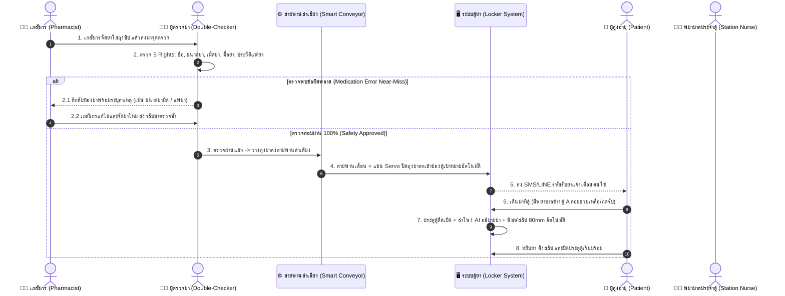

# 📘 คู่มือสถาปัตยกรรมและโครงสร้างโค้ด: Smart Pharmacy Locker
## (ระบบตู้ล็อกเกอร์รับยาอัตโนมัติและผู้ช่วยอธิบายยาสำหรับผู้สูงอายุ)

---

## 1. ที่มาและวัตถุประสงค์ของโปรเจกต์ (Project Background)

### 🔴 ปัญหาที่เกิดขึ้นจริงในโรงพยาบาล (Pain Points)
1. **ความแออัดหน้าห้องจ่ายยา:** ผู้ป่วยและญาติจำนวนมากตรวจกับแพทย์เสร็จตั้งแต่ช่วงสาย แต่ต้องมานั่งรอคิวรับยาหน้าห้องยานาน 1–3 ชั่วโมง ทำให้พื้นที่นั่งรอไม่เพียงพอและเกิดความแออัด
2. **เภสัชกรมีเวลาจำกัดในการอธิบายยา:** เนื่องจากมีผู้ป่วยรอคิวจำนวนมาก ทำให้ต้องเร่งรีบอธิบายการกินยา ส่งผลให้ผู้ป่วยโดยเฉพาะ **ผู้สูงอายุ** ฟังไม่ทัน จำวิธีใช้ยาไม่ได้
3. **คนแก่ลืมวิธีกินยาเมื่อกลับบ้าน:** ฉลากยาบนซองมีตัวหนังสือขนาดเล็ก อ่านยาก และลูกหลานที่ไม่ได้มาด้วยก็ไม่ทราบรายละเอียดที่ชัดเจน

### 🟢 วิธีแก้ปัญหาของระบบนี้ (The Solution)
* **เภสัชกรยังคงเป็นผู้ตรวจและจัดยาลงถุงตามมาตรฐานเดิม 100%** (ถูกกฎหมาย ปลอดภัย ไม่เสี่ยงยาผิดพลาด)
* นำยาที่จัดเสร็จแล้วใส่ลงใน **ตู้ล็อกเกอร์อัจฉริยะ (Smart Pharmacy Locker)**
* ผู้ป่วยหรือญาติสามารถ **เดินมารับยาเวลาไหนก็ได้** ไม่ต้องนั่งรอหน้าห้องยา
* หน้าจอตู้ขนาดใหญ่ ออกแบบมาเพื่อ **ผู้สูงอายุโดยเฉพาะ**:
  - ตัวหนังสือใหญ่ คอนทราสต์ชัดเจน
  - มี **เสียง AI ภาษาไทย** อ่านชื่อยา สรรพคุณ และวิธีกินยาให้ฟังอย่างช้าๆ ชัดเจน
  - มีระบบจำลองส่งสรุปวิธีกินยาเข้า **LINE ของลูกหลาน** ทันทีที่รับยา
  - สามารถพิมพ์ใบสรุปเวลากินยาแผ่นใหญ่กลับไปแปะข้างฝาบ้านได้

---

## 2. โฟลว์การทำงานของระบบ (End-to-End System Workflow)



---

## 3. ผ่าโครงสร้างโฟลเดอร์ของโปรเจกต์ (Folder Structure)

```
smart-pharmacy-locker/
│
├── index.html                   # ไฟล์ HTML หลัก นำเข้า Google Fonts (Prompt/Sarabun)
├── package.json                 # กำหนด Dependencies (React, Lucide, Tailwind, Confetti)
├── vite.config.js               # ตั้งค่า Vite Bundler + Tailwind CSS Plugin
│
├── src/
│   ├── main.jsx                 # Entry Point หลักของ React
│   ├── App.jsx                  # จุดรวม State และจัดการสลับโหมด (Kiosk vs Pharmacist)
│   ├── index.css                # นำเข้า Tailwind CSS และแอนิเมชันปุ่มเรืองแสง
│   │
│   ├── data/
│   │   └── mockData.js          # ข้อมูลจำลอง: รายการยา, คนไข้, ประวัติแพ้ยา, ช่องตู้ 12 ช่อง
│   │
│   ├── services/
│   │   └── voiceService.js      # ตัวควบคุมเสียงพูดภาษาไทย (Web Speech API) สำหรับคนแก่
│   │
│       ├── KioskView.jsx        # หน้าจอหลักของตู้รับยา (สำหรับคนไข้/คนแก่ + ปุ่มเรียกพยาบาล/Staff Mode)
│       ├── DoubleCheckConveyorView.jsx # จุดตรวจยา 5 Rights & ระบบสายพานจำแนกเข้าตู้จำลอง
│       ├── LockerGrid.jsx       # กราฟิกจำลองตู้ล็อกเกอร์ 12 ช่อง (ประตูเปิด/ปิด/ไฟสถานะ)
│       ├── ElderlyMedicineCard.jsx # การ์ดยาแต่ละเม็ด (ตัวหนังสือยักษ์, ไอคอนเวลา, ปุ่มเสียง)
│       ├── PharmacistView.jsx   # หน้าจอของเภสัชกร (บรรจุยาเข้าตู้, ดูสถานะตู้ว่าง)
│       ├── LineModal.jsx        # หน้าต่างจำลองข้อความแจ้งเตือนที่ส่งเข้า LINE ลูกหลาน
│       └── PrintSlipModal.jsx   # หน้าต่างตัวอย่างใบสรุปตารางยากระดาษแผ่นใหญ่
│
└── PROJECT_MANUAL.md            # เล่มคู่มือฉบับนี้
```

---

## 4. เจาะลึกการทำงานของโค้ดแต่ละส่วน (Code Walkthrough)

### 4.1 ศูนย์กลางจัดการ State & สถาปัตยกรรม 2 จอ (Dual-Screen Architecture): `src/App.jsx`
* ทำหน้าที่เป็น **Single Source of Truth** ถือสถานะของตู้ล็อกเกอร์ 12 ช่อง (`lockers`) และรายการใบสั่งยา (`prescriptions`)
* **รองรับสถาปัตยกรรม 2 หน้าจออิสระ (Front & Rear Dual-Screen Terminals):**
  - `displayMode === 'front'` (หรือ URL `?view=front`): หน้าจอติดหน้าตู้สำหรับคนไข้ (Tablet Kiosk)
  - `displayMode === 'back'` (หรือ URL `?view=back`): หน้าจอติดหลังตู้สำหรับผู้ช่วยตรวจยา (Double-Check & Conveyor)
  - `displayMode === 'dual'` (หรือ URL `?view=dual`): โหมดจำลอง 2 หน้าจอเคียงข้างกัน (Split-Screen Simulator) เหมาะกับการพรีเซนต์บนโปรเจกเตอร์หรือจอคอมเครื่องเดียว
* **การซิงก์ข้อมูลแบบ Real-time ข้ามหน้าต่าง (Cross-Window Sync):**
  - ใช้ **Web `BroadcastChannel` API** (`smart_pharmacy_locker_sync`)
  - ทำให้เมื่อเปิดจอหลังบนโน้ตบุ๊ก แล้วเปิดจอหน้าบนแท็บเล็ต เมื่อผู้ช่วยกดปล่อยยาลงสายพาน จอหน้าบนแท็บเล็ตจะอัปเดตและแจ้งเตือนคนไข้ทันทีแบบไร้สาย!

### 4.2 ระบบเสียงพูดภาษาไทยเพื่อคนแก่: `src/services/voiceService.js`
* ใช้ **Web Speech API (`SpeechSynthesis`)** ซึ่งเป็นฟีเจอร์มาตรฐานใน Browser สมัยใหม่ ไม่ต้องเสียเงินซื้อ API ภายนอก
* **เทคนิคที่ออกแบบเพื่อผู้สูงอายุ:**
  - กำหนดภาษา `utterance.lang = 'th-TH'`
  - ปรับความเร็ว `utterance.rate = 0.88` (พูดช้าลงกว่าปกติเล็กน้อย เพื่อให้คนแก่ฟังทัน ไม่พูดรัว)
  - ปรับโทนเสียง `utterance.pitch = 1.05` เพื่อให้เสียงมีความนุ่มนวล อบอุ่น และชัดเจน

### 4.3 กราฟิกจำลองตู้ล็อกเกอร์ 12 ช่อง: `src/components/LockerGrid.jsx`
* จัดเรียงแบบ Grid 4 คอลัมน์ x 3 แถว
* แสดงสถานะของตู้ตามสี:
  - 🟢 **สีเขียวกระพริบ (Active / Unlocked):** ช่องยาของคนไข้คนนี้ ประตูกำลังดีดเปิดอยู่
  - 🔵 **สีน้ำเงิน (Occupied):** มีถุงยาบรรจุอยู่ รอมารับ
  - ⚫ **สีเทา (Available):** ช่องว่าง พร้อมให้เภสัชกรบรรจุยาใหม่
* เมื่อกดที่ช่องสีเขียว จะจำลองการหยิบยาและปิดประตูตู้

### 4.4 การ์ดยาสำหรับสายตาผู้สูงอายุ: `src/components/ElderlyMedicineCard.jsx`
* **ตัวหนังสือขนาดใหญ่พิเศษ (High Contrast):** แยกหมวดหมู่ สี และรูปร่างเม็ดยาชัดเจน
* **ไอคอนเวลาเข้าใจง่าย:** 
  - 🌅 เช้า
  - ☀️ กลางวัน
  - ☕ เย็น
  - 🌙 ก่อนนอน
* **ปุ่มกดฟังเสียงเดี่ยว:** คนแก่สามารถกดปุ่มสีเขียวเพื่อฟังเสียงอธิบายเฉพาะยานั้นๆ ซ้ำกี่รอบก็ได้ โดยไม่ต้องเกรงใจใคร

### 4.5 หน้าจอเภสัชกร: `src/components/PharmacistView.jsx`
* มีฟอร์มบรรจุยาใหม่:
  - กรอกชื่อคนไข้, อายุ, ข้อมูลญาติ
  - ระบบจะแสดงเฉพาะช่องตู้ล็อกเกอร์ที่ว่างอยู่
  - เลือกรายการยาที่บรรจุลงถุง
  - กด "บันทึกและบรรจุยาเข้าตู้" -> ระบบจะสร้างรหัส PIN สุ่ม 4 หลัก และเปลี่ยนสถานะตู้ทันที
  - ประทับตรา **เภสัชกรผู้จัดยา** พร้อม **เลขที่ใบประกอบวิชาชีพ (ภ.)** ลงในใบสั่งยา

### 4.6 ระบบยืนยันตัวตนเจ้าหน้าที่ & บันทึก Audit Trail: `src/components/StaffLoginModal.jsx`
* **การแยกหน้าบ้าน (Public Kiosk) กับหลังบ้าน (Back-Office Guard):**
  - หน้าจอคนไข้ (Kiosk) เป็นสาธารณะ ผู้ป่วยใช้งานได้โดยไม่ต้องใส่รหัส
  - แท็บ **"⚙️ ตรวจยา & สายพาน"** และ **"👨‍⚕️ จัดยาห้องยา"** จะถูกล็อกด้วยระบบ **Staff Authentication Gate**
  - บุคคลภายนอกไม่สามารถเข้าถึงหรือกดจ่ายยาเองได้
* **ระบบความรับผิดชอบและตรวจสอบย้อนกลับ (Accountability & Traceability):**
  - เจ้าหน้าที่เข้าสู่ระบบด้วยรหัส PIN 4 หลัก หรือจำลองแตะบัตร RFID Staff Badge
  - บันทึกรหัสและชื่อเจ้าหน้าที่:
    - 👨‍⚕️ **ภก. ธนวัฒน์ วงศ์วิจิตร** (ภ.34211 / PIN: 1111)
    - 👩‍⚕️ **ภญ. นภาพร สดใส** (ภ.48902 / PIN: 2222)
    - 👩‍⚕️ **พว. กรรณิการ์ รักษาดี** (พ.11892 / PIN: 3333)
  - ข้อมูลทุกใบสั่งยาจะบันทึก **Audit Trail** ประกอบด้วย:
    1. ผู้จัดยา (Dispensed By) + เลขที่ใบประกอบ
    2. ผู้ตรวจสอบซ้ำ (Checked By) + เลขที่ใบประกอบ
    3. เวลาที่ตรวจสอบ (Timestamp)
  - **หากเกิดความผิดพลาดทางยา (Medication Error):** โรงพยาบาลสามารถตรวจย้อนรอย (Audit Log) ได้ทันที 100% ว่าใครเป็นผู้จัดยา และใครเป็นผู้ปล่อยยาเข้าตู้ ตรงตามมาตรฐาน JCI, HA และ GPP ของสภาเภสัชกรรม

---

## 5. วิธีเปิดรันและทดสอบระบบ (How to Run & Test)

### ขั้นตอนการรันโปรเจกต์:
1. เปิด Terminal หรือ PowerShell
2. เข้าไปที่โฟลเดอร์โปรเจกต์:
   ```powershell
   cd "D:\My Project\smart-pharmacy-locker"
   ```
3. รันเซิร์ฟเวอร์สำหรับพัฒนา:
   ```powershell
   npm run dev
   ```
4. เปิดเบราว์เซอร์ไปที่: `http://localhost:3000`

---

## 6. ลำดับขั้นตอนในการทดสอบระบบ (Test Scenarios)

### 🧪 Scenario 1: ทดสอบรับยาในฐานะคนแก่ (Kiosk Mode)
1. อยู่ที่หน้าแรก **"หน้าตู้รับยา (Kiosk คนแก่)"**
2. สังเกตแถบด้านบนจะมี **"ปุ่มทดสอบด่วน (Quick Demo)"** ให้คลิกที่ **"👵 คุณยายสมศรี ตู้ 3"**
3. ระบบจะจำลองว่าคุณยายสแกนรับยาสำเร็จ:
   - พลุกระดาษ confetti จะระเบิดขึ้นฉลอง
   - มี **เสียงพูดภาษาไทย** ต้อนรับคุณยายสมศรี และแจ้งว่าตู้ช่องที่ 3 เปิดแล้ว
   - ที่ผังตู้ล็อกเกอร์ **ช่อง 03 จะกลายเป็นสีเขียวและมีไฟกระพริบ**
   - หน้าจอจะแสดงรายการยาทั้ง 3 ตัวของคุณยายอย่างละเอียด
4. ลองกดปุ่ม **"🔊 กดฟังเสียงอธิบายยานี้"** ที่การ์ดยาแต่ละเม็ด
5. ลองกดปุ่ม **"📱 ส่งวิธีกินยาเข้า LINE ลูกหลาน"** เพื่อดูหน้าต่างจำลองแชท LINE ที่ส่งหาลูกชาย
6. ลองกดปุ่ม **"🖨️ ดู/พิมพ์ใบสรุปยาแผ่นใหญ่"** เพื่อดูตารางยาสำหรับนำไปแปะข้างฝาบ้าน
7. กดปุ่ม **"✅ ปิดประตูตู้ & เสร็จสิ้นการรับยา"**

### 🧪 Scenario 2: ทดสอบจัดยาใหม่ในฐานะเภสัชกร (Pharmacist Mode)
1. สลับแท็บด้านบนขวาไปที่ **"ห้องยา (Pharmacist Portal)"**
2. ในฟอร์มด้านซ้าย:
   - กรอกชื่อคนไข้ เช่น *"คุณตาบุญมี มีทรัพย์"*
   - เลือกช่องตู้ล็อกเกอร์ที่ว่างอยู่ (เช่น ช่อง 1)
   - ติ๊กเลือกยาที่ต้องการจัด (เช่น Amlodipine และ Paracetamol)
   - กดปุ่ม **"บันทึกและบรรจุยาเข้าตู้ล็อกเกอร์"**
3. ตู้ช่อง 1 จะเปลี่ยนสถานะเป็นสีน้ำเงิน (มียารอรับ) และมีรหัส PIN สุ่ม 4 หลักปรากฏขึ้น
4. สลับกลับไปที่หน้า **Kiosk** คุณจะเห็นว่าตู้ช่อง 1 มีคนไข้คนใหม่รอรับยาได้ทันที!

---

## 7. แนวทางการต่อยอดสู่ "ฮาร์ดแวร์ตู้จริง" (Hardware Implementation Guide)

หากต้องการนำโปรเจกต์นี้ไปทำเป็นตู้ของจริง (สำหรับโครงงานจบ, ประกวดนวัตกรรม หรือใช้งานจริง) มีแนวทางดังนี้:

### 1. โครงสร้างตู้และกลอนไฟฟ้า (Locker Cabinet & Solenoid Lock)
* **กลอนไฟฟ้า (12V DC Solenoid Electric Lock):** ติดตั้งที่ประตูล็อกเกอร์แต่ละช่อง เมื่อมีไฟจ่ายเข้าไป สลักจะหดตัวทำให้ประตูดีดเปิดออก
* **บอร์ดรีเลย์ (12-Channel Relay Module):** ทำหน้าที่เป็นสวิตช์เปิด-ปิดไฟ 12V ให้กับกลอนแต่ละช่อง

### 2. ไมโครคอนโทรลเลอร์ควบคุม (Microcontroller)
* ใช้ **ESP32** หรือ **Raspberry Pi**:
  - ต่อเชื่อมกับ Web Application ผ่าน **WebSocket** หรือ **MQTT** หรือ **HTTP REST API**
  - เมื่อคนไข้ยืนยันตัวตนสำเร็จที่หน้า Kiosk -> เว็บส่งคำสั่ง `{"action": "unlock", "slot": 3}` ไปยัง ESP32
  - ESP32 สั่งรีเลย์ช่องที่ 3 ทำงานเป็นเวลา 1.5 วินาที กลอนจะดีดเปิดออก

### 3. อุปกรณ์เสริมสำหรับผู้สูงอายุ
* **เครื่องอ่านบัตรประชาชน (Smart Card Reader USB):** เช่น ยี่ห้อ Zoweetek หรือ Identiv เสียบเข้ากับแท็บเล็ต/คอมพิวเตอร์ Kiosk เพื่อดึงเลขประจำตัวประชาชน 13 หลักมาค้นหายาอัตโนมัติ
* **เครื่องสแกนบาร์โค้ด 2D (Fixed Mount Barcode Scanner):** ฝังไว้ใต้หน้าจอ แค่คนไข้นำใบนัดมายื่นใกล้ๆ ก็สแกนได้ทันทีโดยไม่ต้องเล็ง
* **ไฟ LED แสดงสถานะ (WS2812B NeoPixel Strip):** ติดไว้รอบกรอบประตูแต่ละช่อง เมื่อช่องไหนเปิด ให้ไฟวิ่งเป็นสีเขียวชี้เป้าให้คนแก่เห็นชัดเจนจากระยะไกล
* **เครื่องพิมพ์กระดาษความร้อน 80 มม. ตัดกระดาษอัตโนมัติ (80mm Embedded Thermal Printer with Auto-Cutter):** 
  - ใช้ม้วนกระดาษความร้อน (Thermal Paper Roll 80mm) แบบเดียวกับตู้ ATM / สลิป 7-Eleven
  - ไม่ต้องใช้ตลับหมึกตลอดอายุการใช้งาน ไม่ต้องกลัวหมึกแห้งหรือเลอะ
  - มีใบมีดตัดกระดาษอัตโนมัติ (Auto-Cutter) คนแก่ไม่ต้องออกแรงฉีกกระดาษ แค่ดึงสลิปออกได้เลย
