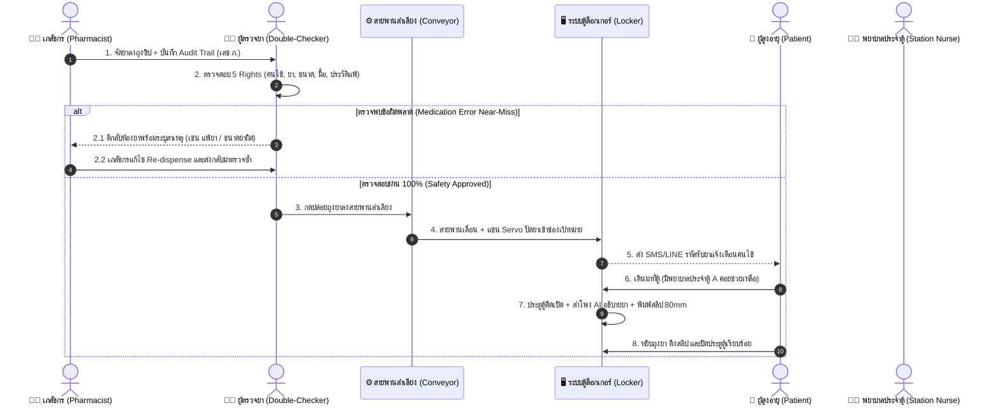

# 🏥 Smart Pharmacy Locker (ตู้รับยาอัจฉริยะ)

> **IoT & AI-Powered Smart Locker System with Conveyor Sorting, 5-Rights Double-Check Station, and Closed-Loop Medication Safety for Elderly Patients**  
> *นวัตกรรมตู้รับยาอัตโนมัติพร้อมระบบสายพานลำเลียงอัจฉริยะ จุดตรวจซ้ำความปลอดภัย 5 Rights และผู้ช่วยอธิบายยาสำหรับผู้สูงอายุ*

---

[](https://react.dev/)
[](https://vitejs.dev/)
[](https://tailwindcss.com/)
[](https://developer.mozilla.org/en-US/docs/Web/API/Web_Speech_API)
[](https://www.jointcommissioninternational.org/)
[](LICENSE)

---

## 📖 บทสรุปโครงการ (Project Overview)

ในโรงพยาบาลรัฐและโรงพยาบาลศูนย์ขนาดใหญ่ ผู้ป่วยนอก (OPD) กว่า 60% เป็น **ผู้สูงอายุ** ซึ่งต้องเผชิญกับ **การรอคอยคิวยาวนาน 2–3 ชั่วโมง** หน้าห้องจ่ายยา เกิดความแออัด เสี่ยงต่อการติดเชื้อ และเมื่อถึงคิว เภสัชกรมีเวลาอธิบายวิธีทานยาเพียงไม่กี่สิบวินาที ทำให้คนแก่ฟังไม่ทัน จำไม่ได้ และเสี่ยงทานยาผิดเมื่อกลับบ้าน

**Smart Pharmacy Locker** ถูกคิดค้นขึ้นเพื่อแก้ปัญหานี้อย่างครบวงจร:
1. **คงความปลอดภัยตามกฎหมาย 100%:** เภสัชกรยังคงเป็นผู้จัดยาลงถุงซิปตามมาตรฐาน
2. **จุดตรวจซ้ำความปลอดภัย (Double-Check Station):** ตรวจสอบ 5 Rights ก่อนนำเข้าตู้ หากพบข้อผิดพลาด มีระบบตีกลับห้องยาทันที (Closed-Loop Near-Miss Interception)
3. **สายพานลำเลียงอัตโนมัติ (Smart Infeed Conveyor):** วางถุงยาลงสายพาน เลื่อนและปัดเข้าช่องตู้ล็อกเกอร์เป้าหมายอัตโนมัติด้วย Servo Diverter
4. **ตู้รับยาเพื่อผู้สูงอายุ (Elderly-Centric Kiosk):** ตัวหนังสือขนาดใหญ่พิเศษ, มี **เสียง AI ภาษาไทย** บรรยายวิธีทานยาช้าๆ ชัดเจน, พิมพ์สลิปกระดาษความร้อน 80mm ตัวยักษ์แปะฝาบ้าน, และส่งข้อมูลเข้า LINE ลูกหลาน
5. **Human Touch Care:** มีปุ่ม **"🆘 เรียกพยาบาล"** และพยาบาลประจำจุดคอยช่วยเหลือผู้สูงอายุที่สายตาไม่ดี

---

## 🌟 ฟีเจอร์เด่นของระบบ (Core Features)

### 1. 🧓 หน้าตู้รับยาคนไข้ (Elderly-Friendly Patient Kiosk)
* **High Contrast & Giant Typography:** ดีไซน์การ์ดยาขนาดใหญ่พิเศษ เห็นชัดแม้มองจากระยะไกล
* **AI Thai Speech Synthesis:** สังเคราะห์เสียงพูดภาษาไทย อธิบายสรรพคุณ มื้อยา และข้อควรระวังช้าลง 0.88x เพื่อผู้สูงอายุ
* **80mm Thermal Printer Simulation:** จำลองการพิมพ์สลิปกระดาษความร้อน 80mm พร้อมตารางมื้อยา เช้า กลางวัน เย็น ก่อนนอน
* **LINE Family Notification:** จำลองการส่งสรุปรายการยาและเวลากินยาเข้า LINE ของลูกหลานทันทีที่รับยา
* **Station Nurse Assist:** ปุ่มเรียกพยาบาลประจำจุด และโหมดเจ้าหน้าที่ช่วยเหลือ (One-Touch Override)

### 2. ⚙️ จุดตรวจซ้ำ & สายพานลำเลียง (Double-Check Station & Infeed Conveyor)
* **5 Rights Safety Checklist:** ตรวจสอบ ถูกคนไข้, ถูกยา, ถูกขนาด, ถูกเวลา, และประวัติการแพ้ยา
* **Smart Conveyor Simulator:** แอนิเมชัน 2D สายพานลำเลียง พร้อมกลไกแขนกั้น Servo ปัดถุงยาตกเข้าช่องตู้
* **ESP32 Hardware Bridge:** รองรับการส่งคำสั่ง HTTP/REST API ไปสั่งงานบอร์ด ESP32 ควบคุมสายพานและ Servo Motor จริง

### 3. 🚨 ระบบสกัดกั้นและตีกลับยาผิด (Closed-Loop Near-Miss Interception)
* **ปุ่ม "❌ ตรวจพบข้อผิดพลาด: ตีกลับห้องยา":** หากผู้ตรวจพบว่าขนาดยาผิด หรือคนไข้มีประวัติแพ้ยา สามารถกดส่งคืนห้องยาได้ทันที
* **Real-time Urgent Alert:** หน้าจอห้องยาจะเด้งแถบเตือนสีแดงกระพริบ `🚨 1 ตีกลับ` ทันทีแบบเรียลไทม์
* **Re-dispense Loop:** เภสัชกรสามารถแก้ไขเม็ดยาและจัดยาใหม่ แล้วส่งกลับเข้าคิวตรวจ Double-Check ได้อย่างสมบูรณ์

### 4. 🔐 ระบบยืนยันตัวตน & ตรวจสอบย้อนกลับ (Staff Access Control & Audit Trail)
* **แยกหน้าบ้านและหลังบ้านอย่างเด็ดขาด:** หน้าตู้คนไข้เป็นสาธารณะ ส่วนหลังบ้านต้องใส่รหัส PIN 4 หลัก หรือแตะบัตร RFID Staff Badge
* **Traceability & Accountability:** ทุกใบสั่งยาบันทึก:
  * `ผู้จัดยา (Dispensed By)` + เลขที่ใบประกอบวิชาชีพเภสัชกรรม (ภ.)
  * `ผู้ตรวจซ้ำ (Checked By)` + เลขที่ใบประกอบวิชาชีพการพยาบาล (พ.)
  * `ผู้ตีกลับ / วันเวลา` เพื่อตรวจสอบย้อนหลังกรณีเกิด Medication Error ตามมาตรฐาน JCI / HA / GPP

### 5. 🖥️+🖥️ สถาปัตยกรรม 2 หน้าจอ (Dual-Screen Architecture)
* **Cross-Window Real-Time Sync:** ซิงก์ข้อมูลระหว่างจอหน้า (Tablet หน้าตู้) และจอหลัง (Laptop ผู้ช่วย) ผ่าน **Web BroadcastChannel API** ไร้ความหน่วง โดยไม่ต้องพึ่งพาเซิร์ฟเวอร์ภายนอก
* **URL Display Modes:**
  * `?view=front` : หน้าจอเฉพาะ Kiosk สำหรับติดหน้าตู้
  * `?view=back` : หน้าจอเฉพาะสถานีตรวจยา & สายพาน สำหรับผู้ช่วยหลังตู้
  * `?view=dual` : โหมดจำลอง 2 หน้าจอคู่กัน (Split Screen) สำหรับพรีเซนต์บนโปรเจกเตอร์

---

## 🔄 แผนผังการทำงาน (System Workflow)



---

## 💻 เทคโนโลยีที่ใช้ (Tech Stack)

* **Frontend Framework:** React 19 (Hooks, Context, Web Speech API, BroadcastChannel)
* **Build Tool:** Vite 8.3
* **Styling & Design System:** Tailwind CSS 4.0, Lucide Icons, Canvas Confetti
* **Speech Synthesis:** Web Speech API (`speechSynthesis`, `lang: th-TH`, `rate: 0.88`, `pitch: 1.05`)
* **Hardware Interfacing:** ESP32 Microcontroller, SG90 Micro Servo, 12V Solenoid Electric Locks, 58/80mm Mini Thermal Printer

---

## 🚀 วิธีติดตั้งและรันระบบ (Getting Started)

### 1. โคลนโปรเจกต์ (Clone Repository)
```bash
git clone https://github.com/underwaves/smart-pharmacy-locker.git
cd smart-pharmacy-locker
```

### 2. ติดตั้ง Dependencies
```bash
npm install
```

### 3. รันเซิร์ฟเวอร์ทดสอบ (Development Server)
```bash
npm run dev
```
เปิดเบราว์เซอร์ไปที่: `http://localhost:3000`

### 4. รันแบบเปิดให้ Tablet / มือถือ เชื่อมต่อผ่าน Wi-Fi
```bash
npm run dev -- --host
```
*(ดูหมายเลข Network IP ที่แสดง เช่น `http://192.168.1.50:3000` เพื่อเปิดบน Tablet)*

---

## 🔑 ข้อมูลเข้าสู่ระบบทดสอบ (Demo Credentials)

| ตำแหน่ง | ชื่อ-นามสกุล | เลขที่ใบประกอบ | รหัส PIN |
| :--- | :--- | :---: | :---: |
| 👨‍⚕️ หัวหน้าเวรห้องยา | ภก. ธนวัฒน์ วงศ์วิจิตร | `ภ.34211` | **`1111`** |
| 👩‍⚕️ เภสัชกรปฏิบัติการ | ภญ. นภาพร สดใส | `ภ.48902` | **`2222`** |
| 👩‍⚕️ พยาบาลตรวจยา & จุดตู้ | พว. กรรณิการ์ รักษาดี | `พ.11892` | **`3333`** |

*(ในหน้าเว็บสามารถกดปุ่ม **"แตะบัตร RFID (Quick Demo)"** เพื่อล็อกอินทันที 1 คลิก)*

---

## 📁 โครงสร้างโปรเจกต์ (Project Structure)

```
smart-pharmacy-locker/
├── src/
│   ├── components/
│   │   ├── KioskView.jsx                # หน้าจอหลักตู้รับยาคนไข้ + เสียง AI + สลิป
│   │   ├── DoubleCheckConveyorView.jsx  # จุดตรวจ 5 Rights + สายพาน + ระบบตีกลับยา
│   │   ├── PharmacistView.jsx           # ห้องยา + บันทึกถุงยา + แก้ไขยาตีกลับ
│   │   ├── StaffLoginModal.jsx          # ประตูยืนยันตัวตนเจ้าหน้าที่ (PIN / RFID)
│   │   ├── LockerGrid.jsx               # แผงจำลองตู้ล็อกเกอร์ 12 ช่อง
│   │   ├── ElderlyMedicineCard.jsx      # การ์ดยาตัวหนังสือยักษ์สำหรับผู้สูงอายุ
│   │   ├── HeroSection.jsx              # หน้าแนะนำโครงการ & Interactive Showcase
│   │   ├── FeatureShowcase.jsx          # สไลด์จุดเด่นของระบบ
│   │   ├── LineModal.jsx                # จำลองข้อความแจ้งเตือนเข้า LINE ลูกหลาน
│   │   └── PrintSlipModal.jsx           # สลิปกระดาษความร้อน 80mm ตารางยากลับบ้าน
│   ├── data/
│   │   └── mockData.js                  # ข้อมูลยา, คนไข้, แพ้ยา, เจ้าหน้าที่, Audit Trail
│   ├── services/
│   │   └── voiceService.js              # โมดูลควบคุมเสียงพูดภาษาไทย (Web Speech API)
│   ├── App.jsx                          # Root State, Dual-Screen Engine, BroadcastChannel
│   ├── main.jsx                         # Entry point
│   └── index.css                        # Tailwind CSS & Conveyor Animation Keyframes
├── PROJECT_MANUAL.md                    # คู่มือสถาปัตยกรรมและโครงสร้างโค้ดฉบับเต็ม
├── PITCH_DECK_BOOKLET.md                # เล่มสคริปต์พิชชิ่ง 5-7 นาที & คลังคำถาม-คำตอบกรรมการ
└── README.md                            # เอกสารแนะนำโครงการนี้
```

---

## 🏆 เอกสารประกอบโครงงาน & การนำเสนอ
* [คู่มือสถาปัตยกรรมระบบ (PROJECT_MANUAL.md)](./PROJECT_MANUAL.md)
* [เล่มบทนำเสนอพิชชิ่ง & คลังคำถามกรรมการ (PITCH_DECK_BOOKLET.md)](./PITCH_DECK_BOOKLET.md)

---

## 📄 สิทธิ์การใช้งานและการขออนุญาต (License & Contact)

ผลงานชิ้นนี้ได้รับการคุ้มครองลิขสิทธิ์ภายใต้ **All Rights Reserved (สงวนลิขสิทธิ์ทุกประการ)**:
* **อนุญาต:** ให้เข้าชมและศึกษาโครงสร้างเพื่อการตรวจประเมินผลงานทางวิชาการและการนำเสนอพอร์ตโฟลิโอเท่านั้น
* **ไม่อนุญาต:** ให้นำโค้ดหรือระบบไปดัดแปลง ทำซ้ำ ผลิตตู้จริง หรือนำไปใช้ในเชิงพาณิชย์โดยไม่ได้รับอนุญาต

📫 **หากสนใจนำระบบไปใช้งานจริง พัฒนาต่อยอด หรือประยุกต์ใช้ในองค์กร กรุณาติดต่อขออนุญาตเป็นลายลักษณ์อักษรได้ที่:**
* **ผู้ถือลิขสิทธิ์ (Author):** underwaves
* **อีเมล (Email):** [woranatxawq@gmail.com](mailto:woranatxawq@gmail.com)
* **GitHub Profile:** [@underwaves](https://github.com/underwaves)

---
<p align="center">
  พัฒนาด้วยความใส่ใจเพื่อสุขภาวะที่ดีของผู้สูงอายุและครอบครัวไทย ❤️
</p>
